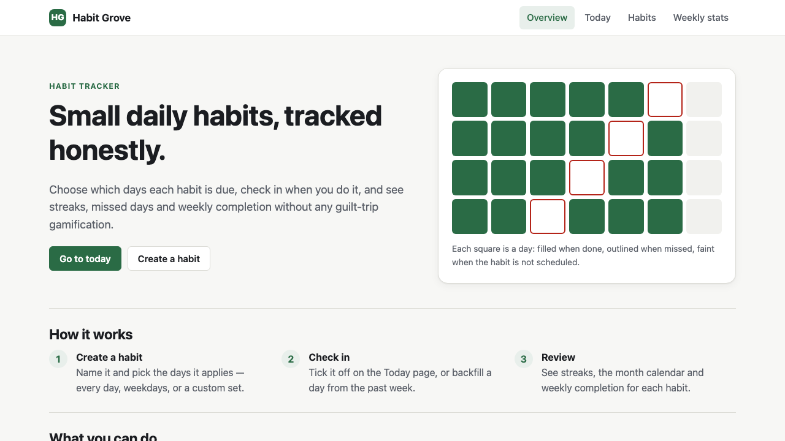

# Habit Grove

A habit tracker with per-habit schedules, daily check-ins, streaks that respect rest days, missed-day lists, a month calendar and weekly statistics.


| Mobile | Landing |
| --- | --- |
|  |  |

## Run it

```bash
npm install
npm run dev        # http://localhost:5103
npm test
npm run build
npm run test:e2e   # Playwright smoke test (npm run e2e:install once if Chromium is missing)
```

## Main workflow

1. **Habits** → name a habit, choose its scheduled days (presets: every day / weekdays / weekends) and a colour.
2. **Today** → press the round button to check in. The 7-day strip lets you backfill a forgotten day.
3. Open a habit to see its **month calendar**, current and longest streak, 30-day completion rate and missed days from the last two weeks (each with a “Mark as done” shortcut).
4. **Weekly stats** → check-ins per day as a bar chart and a per-habit table; step back through previous weeks.

Demo content: **Load demo habits** on the empty Today or Habits page creates three habits (prefixed “Demo:”) with four weeks of deterministic history.

## Rules the app follows

- A streak counts consecutive *scheduled* days that were completed. Rest days neither add to nor break it.
- Today does not break a streak until it is over.
- Completion rate = completed scheduled days ÷ scheduled days elapsed in the last 30 days (an unfinished today is excluded).
- Check-ins for future days are rejected with an error message.

## States covered

Empty (no habits, no stats), validation (missing / duplicate / long names, no days selected), success (created, updated, deleted, checked in), error (future check-in), not found (deleted habit URL).

## Tests

- `src/lib/habits.test.ts` — streaks across rest days and an unfinished today, longest streak, day states, missed days, toggle + future rejection, completion rate, weekly summary, month grid, validation.
- `src/App.test.tsx` — empty state, create with validation → check-in → streak, demo data → stats.
- `e2e/smoke.spec.ts` — create → check in → reload → calendar → stats → delete → demo, plus 375px layout check.

## Limitations

- No reminders or notifications.
- Changing a habit's schedule re-interprets past days with the new schedule (history is not versioned).
- Habits are “done / not done” only; counts (e.g. 8 glasses of water) are not supported.
- One device only.

## Future improvements

- Quantity-based habits with daily targets.
- Schedule history so past streaks are not affected by later schedule edits.
- CSV export of check-ins.
