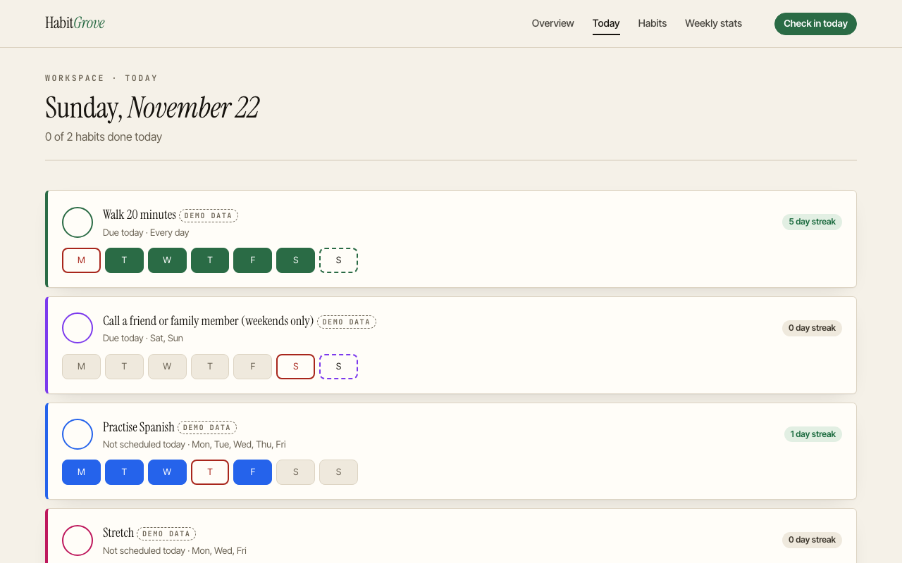
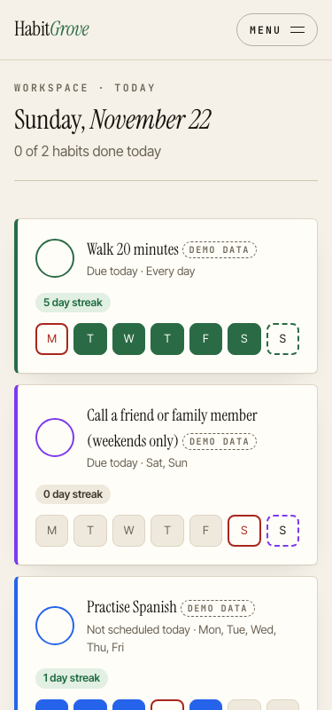

# Habit Grove

A habit tracker built around a calendar heatmap: per-habit schedules, daily check-ins, streaks that respect rest days, missed-day lists, a month calendar and weekly statistics.


| Today | Mobile |
| --- | --- |
|  |  |

## Run it

```bash
npm install
npm run dev        # http://localhost:5103
npm test
npm run build
npm run test:e2e   # Playwright smoke test (npm run e2e:install once if Chromium is missing)
```

## Main workflow

1. The app opens with four labelled **demo habits** and 12 weeks of history (one has a long name, one is weekend-only and new). **Habits → Clear demo habits** removes them and shows the empty state.
2. **Habits** → name a habit, choose scheduled days (presets: every day / weekdays / weekends) and a colour.
3. **Today** → press the round button to check in; the 7-day strip backfills a forgotten day.
4. Open a habit for its **month calendar**, current/longest streak, 30-day rate and missed days (each with “Mark as done”).
5. **Weekly stats** → 12-week heatmap (with legend and per-day tooltips), a per-day bar chart and a per-habit table.

## Rules

- A streak counts consecutive *scheduled* days completed. Rest days neither add to nor break it; today doesn’t break it until it’s over.
- Completion rate = completed scheduled days ÷ scheduled days elapsed in the last 30 days (unfinished today excluded).
- Heatmap shade = share of that day’s scheduled habits completed.
- Future check-ins are rejected with an error message.

## Design

Shared editorial system (see the portfolio README): Instrument Serif display type with italic accents, Inter Tight UI text, mono labels, warm paper workspace and an ink hero whose preview is the real heatmap component rendering demo data. Motion: staggered hero entrance, heatmap columns rising in sequence, scroll reveals and route cross-fades — all disabled under `prefers-reduced-motion`.

## Tests

- `src/lib/habits.test.ts` — streaks across rest days and unfinished today, longest streak, day states, missed days, toggle + future rejection, completion rate, weekly summary, month grid, validation.
- `src/App.test.tsx` — default demo data, empty state, create with validation → check-in → streak, demo → stats with heatmap.
- `e2e/smoke.spec.ts` — landing, create → check in → reload → calendar → stats → delete → demo, plus 375px checks.

## Limitations

- No reminders or notifications.
- Editing a schedule re-interprets past days (history isn’t versioned).
- Done / not done only — no quantities.
- One device only.

## Future improvements

- Quantity habits with daily targets; schedule history; CSV export.
